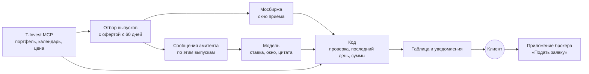

# Перед пут-офертой: ставка, последний день и две суммы

По выпускам своего портфеля с близкой пут-офертой человек видит новую ставку и окно приёма из сообщения эмитента, последний день, когда брокер ещё принимает бумагу по номиналу, и две суммы: деньги при сдаче и купон, если оставить. Без совета и без заявок.

Проект команды для программы «Инвест. Премаркет» (Т-Банк, 2026). Впереди System Build (23 ноября — 3 декабря).

> Это информация, а не индивидуальная инвестиционная рекомендация. Слов «сдавайте», «оставляйте», «выгоднее» нет. Заявку человек подаёт сам в приложении брокера.

## Почему именно оферта

Мы проверяли, помогает ли держателю облигаций узнавать о проблемах эмитента из текстов: сообщений, релизов агентств, новостей. В 4 из 5 разобранных случаев сообщение выходило в день падения цены или позже, то есть рынок реагировал раньше текстов.

Исключение — оферта. У «Хромос Инжиниринг» (БО-01) эмитент 6 ноября 2026 раскрыл ставку 1% годовых до погашения и приём бумаг на выкуп по номиналу 9–13 ноября. Закрытие на Мосбирже: 6 ноября — 99,19%, 12 ноября — 99,31%, 13 ноября — 72,52%. Кто прочитал сообщение и успел подать заявку, вернул номинал. Кто не прочитал, остался с бумагой около 73% номинала и купоном 1%. У брокера последний день подачи был 10 ноября: от раскрытия до него — два рабочих дня.

Оферта — единственная ситуация, где сообщение эмитента выходит раньше падения цены и у человека есть действие без убытка.

## Для кого

Частный клиент, который сам держит корпоративные облигации, и у части из них есть пут-оферты. Управляющего нет. По каждой бумаге с офертой он сам решает, сдать её по номиналу или оставить, и сам подписывает поручение.

## Чего нет на экранах

- **Новой ставки.** Она выходит отдельным сообщением эмитента. У «Хромоса» это была фраза «1% годовых до конца обращения», а не поле на карточке.
- **Окна приёма.** У биржи оно есть не всегда: по «Хромосу» окно 9–13 ноября заполнено, а у БО-03 «Сибнефтехимтрейда» на оферту 25 августа 2026 поля пустые, хотя приём шёл 10–14 августа. Тогда окно есть только в сообщении эмитента.
- **Последнего дня у брокера.** Брокер принимает поручение не позднее чем за три рабочих дня до конца приёма у эмитента. На карточке выпуска стоит день расчётов.
- **Сумм по своей позиции.** Сколько вернётся при сдаче и сколько купона будет, если оставить.

## Что получает человек

По каждому выпуску портфеля с пут-офертой в ближайшие 60 дней:

| Поле | Откуда |
|---|---|
| Выпуск, количество, цена к номиналу | Портфель через T-Invest MCP |
| Новая ставка и номера купонов, с цитатой и ссылкой | Сообщение эмитента — извлекает модель |
| Окно приёма у эмитента | Мосбиржа; если там пусто — сообщение эмитента |
| Последний день подачи у брокера | Код: конец приёма минус три рабочих дня |
| Деньги при сдаче по номиналу | Код: номинал × количество × цена выкупа |
| Купон, если оставить | Код: новая ставка × номинал × количество до следующей оферты или погашения |

Уведомление приходит, когда эмитент опубликовал ставку или окно, и ещё раз — за два рабочих дня до последнего дня подачи. Пример на 10 бумагах «Хромоса»: при сдаче 10 000 ₽; если оставить — купон около 128 ₽ до погашения в марте 2028.

## Что делает модель и что делает код

| Кто | Что делает |
|---|---|
| Модель | Читает сообщение эмитента по выпуску с близкой офертой и заполняет схему: серия и ISIN, новая ставка, номера купонов, начало и конец приёма, цена выкупа, дословная цитата |
| Код | Проверяет, что цитата дословно есть в сообщении и ISIN совпадает с выпуском; сверяет окно с биржей; считает последний день подачи и обе суммы; собирает таблицу и уведомления |

Модель не советует, не оценивает и не отправляет заявки. Если цитаты нет в тексте, ISIN не совпал или окно у биржи и в сообщении расходится, число не показывается — вместо него стоит пометка и ссылка на сообщение.

## Зачем T-Invest MCP

Только чтение, торговые инструменты не вызываются.

1. Портфель — какие облигации на счёте и сколько штук.
2. Календарь облигаций — у каких выпусков оферта в ближайшие 60 дней.
3. Цена — текущая цена к номиналу.
4. Справочник — ISIN, номинал, параметры выпуска.

Без MCP нет «ваших» выпусков, количества и сумм: остаётся общий календарь оферт, который уже есть у агрегаторов.

## Архитектура



## Как проверим

- **Расчёт.** Последний день подачи и суммы совпадают с ручным расчётом на всех офертах тестового набора — порог 100%, это арифметика.
- **Извлечение.** На 30–50 сообщениях эмитентов об офертах 2025–2026 годов модель верно достаёт ставку и окно минимум в 95% случаев, цитата совпадает с текстом в 100%. Порог выше обычного, потому что число идёт в расчёт денег. Всё сомнительное показывается пометкой, а не числом.
- **Где нужна модель.** По тем же офертам считаем, у скольких окно отсутствовало у биржи и сколько дней ставка была только в тексте.
- **Польза.** 5 интервью с держателями облигаций с офертами: как они решали в последний раз, и понимают ли таблицу без пояснений. Успех — минимум трое из пяти понимают её и говорят, что решали бы по ней.

## Первая версия к концу System Build

Портфель и календарь через MCP, окна с Мосбиржи, сообщения эмитентов по выпускам с близкой офертой, извлечение ставки и окна моделью с проверкой цитаты, расчёт дня и сумм, таблица и уведомления на веб-странице. Демо — на реальных офертах: «Хромос» (ноябрь 2026), БО-03 (август 2026) и ближайшие оферты декабря в живом режиме.

Не входит: сводка новостей и рейтингов по эмитентам, колл-оферты и амортизации, пуш-уведомления, вход через T-ID, акции, любые заявки.

## Риски

| Риск | Чем грозит | Как проверяем или снижаем |
|---|---|---|
| Оферты редки | У одного человека их немного в году | Интервью: сколько выпусков с офертами в портфеле; у «Хромоса» одна пропущенная оферта стоила около 27% вложенного |
| Банк добавит поля на экран | Дата и суммы — задача интерфейса | Ставка и окно из текста эмитента, когда их нет в данных, — это не поле; замер, как часто так бывает |
| Модель ошибается в ставке | Неверная сумма купона | Дословная цитата, сверка ISIN и окна с биржей, сомнительное — пометкой |
| Доступ к сообщениям | Порталов раскрытия несколько | Берём только сообщения по выпускам с близкой офертой: единицы в неделю, 2–3 портала |
| MCP отдаёт не то | Нет портфеля или календаря | Проверка в первый день; запасной вариант — прямой T-Invest API с тем же токеном |
| Похоже на рекомендацию | Регуляторные претензии | Без оценок и слов «сдавайте» / «оставляйте», пометка «информация» |

## Структура репозитория

```
.
├── README.md                              обзор проекта
├── docs/
│   ├── sprint-2-submission.md             гипотеза, сданная во втором спринте (сводка; до перехода на оферты)
│   ├── architecture.md                    архитектура версии со сводкой, обновляется
│   ├── data.md                            источники данных, обновляется
│   └── experiment.md                      протокол проверки, обновляется
├── schemas/
│   └── event_classification.schema.json   контракт извлечения, обновляется под сообщения об офертах
└── db/
    └── schema.sql                         схема PostgreSQL, обновляется
```
