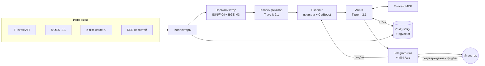

# Радар портфеля

AI-агент, который каждый день разбирает события по бумагам в портфеле инвестора и показывает только то, что требует внимания: что случилось, почему это важно именно для этого портфеля, где источник и какое действие можно подготовить.

Проект команды для программы «Инвест. Премаркет» (Т-Банк, 2026). Стадия: концепция и архитектура MVP.

> Решение не даёт индивидуальных инвестиционных рекомендаций. Агент объясняет события и готовит действие, но выполняет его только после явного подтверждения пользователя.

## Проблема

У частного инвестора в портфеле десятки бумаг, особенно облигаций. По ним постоянно идут события: купоны, оферты, погашения, дивидендные отсечки, даты отчётности, существенные факты, новости. Критичные события (оферта с коротким окном подачи поручения, техдефолт, реструктуризация, изменение условий выпуска) тонут в общем шуме.

**Как сейчас:** инвестор читает общую ленту новостей и уведомлений, сам отслеживает календарь и раскрытие эмитентов. Важное легко пропустить, а реакция запаздывает.

**Для кого:** частные инвесторы Т-Инвестиций, у которых в портфеле больше нескольких бумаг, прежде всего держатели облигаций.

## Основной сценарий: ежедневный разбор событий

| Шаг | Что происходит |
|---|---|
| Вход | Состав и доли портфеля (T-Invest MCP), календарь купонов, оферт, погашений, дивидендов и отчётности, существенные факты эмитентов, новости, котировки и объёмы |
| Сбор | События собираются по каждой бумаге портфеля, дубли одного события из разных источников склеиваются |
| Понимание | LLM определяет тип события, серьёзность, нужно ли действие и до какого срока |
| Ранжирование | Скоринг учитывает долю бумаги в портфеле и срочность |
| Карточка | Агент собирает карточку: что случилось, почему важно для этого портфеля, ссылка на источник, предлагаемое действие |
| Результат | Лента «Требует действия / Важно знать / Фон», утренний дайджест, критичное приходит пушем сразу |
| Дальше | Инвестор подтверждает подготовленное действие (заявка, стоп, напоминание подать поручение на оферту) или отклоняет. Отметка «полезно / шум» идёт в дообучение скоринга |

## Что делает AI и почему не правила

AI отвечает за понимание текстов и оценку значимости: читает сообщения эмитентов, новости и отчёты, определяет, что произошло и с какой бумагой, насколько это серьёзно, нужно ли действие и к какому сроку, и объясняет это простым языком применительно к портфелю.

Правилами это не решить: одно и то же событие (техдефолт, реструктуризация, новая ставка купона) формулируется по-разному, ключевые слова дают ложные срабатывания и пропуски, а важность зависит от сочетания факторов: типа бумаги, доли, срока, положения эмитента.

Даты, пороги и доли считает обычный код. AI используется только там, где нужен смысл текста.

| Подход | Зачем |
|---|---|
| LLM | Классификация событий по тексту и объяснение для пользователя |
| RAG | Объяснения опираются на документы эмитента и исходное сообщение со ссылкой, это снижает галлюцинации |
| AI-агент | Через T-Invest MCP получает портфель и контекст, готовит действия на подтверждение |
| Классическое ML | CatBoost: дешёвое и объяснимое ранжирование по признакам и фидбеку |

## Архитектура



Подробно: компоненты, потоки, выбор технологий и безопасность агента описаны в [docs/architecture.md](docs/architecture.md).

| Компонент | Технологии |
|---|---|
| Коллекторы | Python, запуск по расписанию; T-Invest API, MOEX ISS, e-disclosure.ru, RSS |
| Нормализатор | Привязка к ISIN/FIGI, дедупликация по эмбеддингам BGE-M3 |
| Классификатор | T-pro-it-2.1 (open-source модель Т-Банка) через vLLM, вывод строго по JSON-схеме |
| Скоринг | Правила на старте, затем CatBoost на фидбеке |
| RAG | pgvector-индекс по документам эмитентов |
| Агент | T-pro-it-2.1 + T-Invest MCP, действия только после подтверждения |
| Интерфейс | Telegram-бот (пуши, дайджест, кнопки подтверждения) и Mini App с лентой, бэкенд FastAPI |
| Хранилище | PostgreSQL + pgvector: события, портфели, фидбек, документы, очередь задач |

Ключевая экономия: событие классифицируется **один раз для всех пользователей**, персональным остаётся только дешёвый скоринг и сборка карточки.

## Данные

| Данные | Источник | Формат | Обновление |
|---|---|---|---|
| Портфель и операции | T-Invest API / MCP | JSON | При каждом запуске, с согласия пользователя |
| Купоны, оферты, погашения, дивиденды, даты отчётности | T-Invest API, MOEX ISS | JSON | Раз в сутки |
| Существенные факты | e-disclosure.ru | HTML / PDF | Каждые 10-15 минут |
| Документы для RAG: условия выпусков, отчётность | e-disclosure.ru | PDF | При появлении |
| Новости | RSS / API СМИ | Текст | Каждые 10-15 минут |
| Котировки и объёмы | T-Invest API | Свечи | Ежеминутно |
| Фидбек пользователей | Своя БД | Таблицы | Постоянно |

Ограничения: у раскрытия нет единого удобного API, часть документов в PDF; новости дублируются и не всегда привязаны к тикеру; размеченного датасета важности событий нет, размечаем сами. Подробнее в [docs/data.md](docs/data.md).

## Как проверим, что работает

**Гипотеза:** AI-триаж находит события, требующие действия по портфелю, лучше простых правил и при этом сильно сокращает число уведомлений.

- **Данные:** события за 6-12 месяцев по 100-150 бумагам (облигации и акции), 20 модельных портфелей; 600-800 событий вручную размечают два разметчика по классам «требует действия / важно / фон».
- **База для сравнения:** (а) все события подряд, как в обычной ленте; (б) правила по ключевым словам и порогам цены.
- **Основная метрика:** recall@5, доля событий «требует действия», попавших в топ-5 дневной ленты портфеля.
- **Порог успеха:** recall@5 ≥ 0,9 и на 20+ п.п. выше правил; не более 5% ошибочных объяснений при ручной проверке.

Протокол эксперимента: [docs/experiment.md](docs/experiment.md).

## Риски

| Риск | Почему критично | Как проверить заранее |
|---|---|---|
| Спрос | Инвесторы проигнорируют ещё одну ленту: нет ценности, нет продукта | 15-20 интервью и тест бота на 20 людях (доля открытых карточек) |
| Данные | Раскрытие без удобного API, часто в PDF: нечего ранжировать | За 2 дня собрать события за месяц по 50 бумагам и сверить с ручным списком |
| Качество AI | Пропуск критичного или неверное объяснение дают ложное спокойствие и бьют по репутации | Прогон LLM на 200 размеченных событиях до основной разработки |
| Регуляторика | Объяснение с действием могут счесть индивидуальной инвестиционной рекомендацией | Формулировки с комплаенсом и менторами; действие только по решению пользователя |
| Стоимость | LLM на большом потоке событий съест экономику | Расчёт стоимости GPU на 1000 событий в день; каждое событие классифицируется один раз для всех |


## Структура репозитория

```
.
├── README.md                              обзор проекта
├── docs/
│   ├── architecture.md                    компоненты, потоки, выбор технологий, безопасность агента
│   ├── data.md                            источники данных и их ограничения
│   └── experiment.md                      протокол первого эксперимента
├── schemas/
│   └── event_classification.schema.json   контракт вывода LLM-классификатора
└── db/
    └── schema.sql                         схема PostgreSQL + pgvector
```
