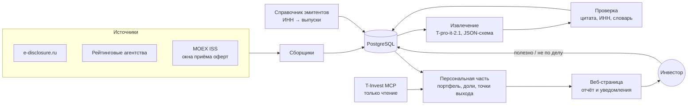

# Сводка информационного фона по облигациям портфеля

Еженедельный отчёт по эмитентам облигаций в портфеле инвестора и уведомление, только когда о них публикуют что-то про выплаты, рейтинг или условия выпуска. В каждой записи — что опубликовано, дословная цитата и ссылка на первоисточник, каких бумаг инвестора это касается и где ближайшая точка выхода по номиналу. Решение принимает сам инвестор.

Проект команды для программы «Инвест. Премаркет» (Т-Банк, 2026). Стадия: гипотеза принята, главное предположение проверено на 6 эмитентах, впереди System Build (23 ноября — 3 декабря).

> Сводка информационная. В ней нет оценок, уровней риска и слов «покупать», «продавать», «держать». Она не является индивидуальной инвестиционной рекомендацией.

## Для кого

**Купонный инвестор.** Сам держит облигации пяти и более эмитентов, в том числе высокодоходные. Покупает ради купона, а не ради сделок: цель — доход выше вклада и вернуть номинал. Заходит в приложение раз в несколько дней, терминалом не пользуется.

**Вне скоупа — активные трейдеры.** Им нужен поток в реальном времени, а не отчёт раз в неделю, и для них есть другие инструменты.

**Почему только облигации.** У облигаций есть проблема, которой нет у акций: эмитент может не вернуть долг, а выйти по номиналу можно только в определённое окно — через оферту или погашение. Информационный фон по акциям и так закрывают новости, Пульс и аналитика. Другие инструменты — после того, как ценность подтвердится на облигациях.

## Проблема

Купонный инвестор держит облигации пяти и более эмитентов. О событиях у эмитента он узнаёт по факту невыплаты, когда цена уже упала: пометки в приложениях и сторонних сервисах появляются после события.

При этом публикации об эмитенте выходят раньше: релизы рейтинговых агентств, сообщения эмитента, новости о выплатах по его другим инструментам. Главное в них часто не в заголовке, а внутри текста. Прочитать всё по пяти и более эмитентам человек не может, а в поле карточки облигации такие тексты не выводятся.

Пример: у «ЕвроТранса» рейтинг был понижен до ruC 19 марта 2026, первая невыплата по биржевому выпуску стала известна 7–8 апреля, полный дефолт по трём выпускам Мосбиржа зафиксировала 5 августа.

## Что получает инвестор

Главный риск такого продукта — превратиться в ещё одну ленту, которую пролистывают. Поэтому формат такой:

- **по умолчанию тишина** — ничего не приходит, если по эмитентам портфеля не было публикаций о выплатах, рейтинге или условиях выпуска;
- **уведомление** — только когда такая публикация появилась; по нашей проверке это редкие события, а не ежедневный поток;
- **еженедельный отчёт** — по строке на эмитента: «без изменений» или список событий, плюс ближайшие оферты и погашения с последним днём подачи;
- **рутина свёрнута** — «купон выплачен в срок» и похожие события видны только в отчёте и в уведомления не попадают.

Запись в отчёте или уведомлении:

- что опубликовано — главное из каждого текста одной строкой, тип события, дословная цитата и ссылка;
- хронология публикаций за 90 дней, сгруппированная по типам событий;
- какие выпуски инвестора это касается, их доля в портфеле и цена к номиналу;
- ближайшая точка выхода по номиналу (оферта, погашение, амортизация) и последний день подачи заявки у брокера: конец приёма у эмитента минус три рабочих дня.

В каждом отчёте есть строка «отсутствие новых публикаций не означает отсутствие риска».

## Что делает AI и что делает код

| Кто | Что делает |
|---|---|
| Модель | Читает полный текст и заполняет строгую схему: компания и ИНН, связанные компании, что произошло одной строкой, тип события, касается ли оно выплат, рейтинга или условий выпуска, дата, дословная цитата |
| Код | Проверяет, что цитата дословно есть в источнике; привязывает запись к эмитенту по ИНН и ко всем его выпускам; собирает хронологию; читает портфель; считает доли, цены и последний день подачи; собирает сводку по шаблону |

Модель не оценивает, не советует и не отправляет заявки. Без модели не обойтись: заголовки сообщений часто рутинные, тексты агентств и новостей не стандартизованы, событие у поручителя или дочерней компании не привязать к выпускам по ключевым словам.

## Зачем T-Invest MCP

Только чтение, торговые инструменты не вызываются.

1. Портфель — какие эмитенты у инвестора и сколько бумаг.
2. Справочник — все выпуски эмитента (актив и его инструменты).
3. Выплаты — оферты, погашения, дата дефолта из календаря событий облигации.
4. Цена — цена к номиналу.

## Архитектура



Подробно: [docs/architecture.md](docs/architecture.md).

## Как проверим, что работает

Первая проверка на 6 эмитентах с дефолтом в 2025–2026 годах: у 4 из 6 публикация о рейтинге, выплатах или условиях вышла за 19–78 дней до первой невыплаты по биржевому выпуску, у 2 из 6 первой новостью была сама невыплата. Уровень рейтинга заранее почти не меняется; ранние сведения — статус «под наблюдением», сбои по внебиржевым инструментам, заявления эмитента, блокировка счетов, нарушение ковенант в отчётности.

Дальше — ретро-прогон на 20–30 эмитентах с дефолтом и стольких же без кредитных событий. Сравниваем отчёт с пометкой по факту невыплаты и с правилами по заголовкам:

- доля дефолтных эмитентов, у которых публикация опередила первую невыплату минимум на 14 дней, и распределение запаса времени;
- опережение правил по заголовкам;
- компания и тип события определены верно не меньше чем в 90% записей на 300 размеченных текстах; цитата дословно совпадает с источником в каждой записи;
- объём: сколько уведомлений в месяц получает портфель из эмитентов без кредитных событий.

Запас в фиксированное число дней не обещаем: отчёт опережает невыплату там, где эмитент или агентство что-то публиковали. Протокол: [docs/experiment.md](docs/experiment.md).

## Первая версия к концу System Build

Входит: сообщения эмитентов с e-disclosure, релизы рейтинговых агентств, новости о выплатах эмитента по другим инструментам («народные» облигации, ЦФА) и его заявлениях, извлечение с проверкой цитаты, портфель и выпуски через MCP, отчёт и уведомления на веб-странице, ретро-прогон как демо.

Во второй очереди: нарушение ковенант в отчётности (первым), блокировки счетов, реестр заявлений о банкротстве, порядок записей по отметкам инвесторов.

## Риски

| Риск | Почему важно | Как проверяем |
|---|---|---|
| Перегрузка | Отчёт превращается в ленту, которую пролистывают | Тишина по умолчанию, уведомления только о выплатах, рейтинге и условиях; объём уведомлений — метрика ретро-прогона и вопрос интервью |
| Спрос | Ни одного интервью с купонными инвесторами пока нет | 5 интервью до System Build по скрипту, показ макета отчёта |
| Данные | Тексты за прошлые периоды могут быть недоступны или закрыты условиями использования | До старта: выгрузка текстов по 5 эмитентам за 12 месяцев, проверка условий сайтов |
| Качество извлечения | Неверная компания или тип события вводят в заблуждение | 300 размеченных текстов, проверка цитаты кодом, сомнительное не показывается |
| Ценность | Публикаций раньше невыплаты может не быть | Ретро-прогон до разработки интерфейса |
| Регуляторика | Сводку могут принять за рекомендацию | Шаблон без оценок, проверка запрещённых слов, маркировка «информация» |
| MCP | Сейчас для собственного использования клиентом-физлицом | В MVP — токен инвестора на чтение; для продукта — T-ID по договору или встраивание в приложение |
| Вычисления | Модель на 33B требует GPU | Каждый текст обрабатывается один раз для всех; при нехватке GPU — квантованная версия |

## Структура репозитория

```
.
├── README.md                              обзор проекта
├── docs/
│   ├── sprint-2-submission.md             гипотеза решения, принятая на Премаркете
│   ├── architecture.md                    компоненты, потоки, выбор технологий, ограничения
│   ├── data.md                            источники, справочник эмитентов, разметка
│   └── experiment.md                      протокол ретро-прогона
├── schemas/
│   └── event_classification.schema.json   контракт вывода модели (извлечение события)
└── db/
    └── schema.sql                         схема PostgreSQL
```
