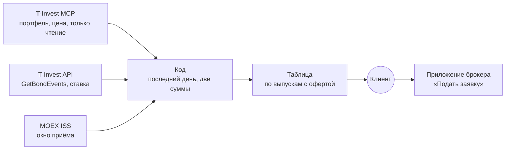

# Пут-оферты портфеля: последний день и две суммы

По своим облигациям с пут-офертой показываем последний день, когда брокер ещё принимает бумагу по номиналу, и две суммы: деньги при сдаче по номиналу и купон, если оставить. Без совета и без заявок.

Проект команды для программы «Инвест. Премаркет» (Т-Банк, 2026). Впереди System Build (23 ноября — 3 декабря).

> Это информация, а не индивидуальная инвестиционная рекомендация. Слов «сдавайте», «оставляйте», «выгоднее» нет. Заявку человек подаёт сам в приложении брокера.

## Для кого

Частный клиент, у которого две и больше корпоративных облигаций с пут-офертой в ближайшие два месяца. Управляющего нет. По каждой бумаге он сам решает, сдать её по номиналу или оставить, и сам подписывает поручение.

## Проблема

- На карточке выпуска датой оферты стоит день расчётов. Брокер принимает поручение раньше: не позднее чем за три рабочих дня до конца приёма у эмитента. Этого дня на экране нет.
- Окно приёма заявок у эмитента есть в календаре облигаций Мосбиржи, но его нет в `GetBondEvents` T-Invest API.
- Новая ставка купона на следующий период выходит отдельным сообщением эмитента.
- Решать приходится по нескольким выпускам в одну неделю, а экран облигации открывается по одной бумаге.

## Что показываем

Одну таблицу по выпускам портфеля с близкой пут-офертой:

| Поле | Откуда |
|---|---|
| Выпуск и количество бумаг | Портфель, T-Invest MCP |
| Окно приёма у эмитента | Календарь облигаций Мосбиржи |
| Последний день подачи у брокера | Код: конец приёма минус три рабочих дня по производственному календарю |
| Деньги при сдаче по номиналу | Код: номинал × количество |
| Купон, если оставить | Код: новая ставка × номинал × количество за купонные периоды до следующей оферты или погашения |
| Новая ставка и ссылка на источник | T-Invest API, если ставка там есть; иначе «ставка ещё не опубликована» |

Рядом — текущая цена к номиналу и переход к кнопке «Подать заявку» в приложении брокера.

## Пример: БО-03 «Сибнефтехимтрейда»

- Приём бумаг у эмитента — 10–14 августа 2026, расчёты — 25 августа.
- Конец приёма — пятница 14 августа. За три рабочих дня до него — вторник 11 августа. Это последний день, когда брокер принимает поручение.
- На карточке выпуска стоит 25 августа. Между последним днём подачи и датой на карточке — 14 дней.
- Ставка на купоны 34–43 — 25% годовых — опубликована 5 августа отдельным сообщением.

## Что делает код и где нужна модель

Первая версия — только код: портфель, окно приёма, последний день подачи и обе суммы.

Модель — вторая очередь и только при одном условии: замер на 3–5 офертах покажет, что в день сообщения эмитента новой ставки ещё нет в `coupon_interest_rate` и в купонном расписании. Тогда модель достаёт из сообщения серию, ISIN, ставку, номера купонов и цитату. Дни и рубли по-прежнему считает код. Если замер дыру не покажет, модель не строим.

## Зачем T-Invest MCP

Только чтение, торговые инструменты не вызываются.

1. Портфель — какие облигации на счёте и сколько штук.
2. Цена — текущая цена к номиналу.
3. Календарь облигации — дата оферты и ставка, если они уже есть в данных.
4. Справочник — ISIN и параметры выпуска.

Окно приёма MCP не отдаёт, его берём из календаря Мосбиржи.

## Архитектура



## Как проверим

**Гипотеза.** Если держателю двух и более выпусков с пут-офертой показать по всем таким выпускам последний день подачи у брокера и две суммы без совета, доля выпусков с решением «подаю» или «оставляю» до этого дня вырастет по сравнению с карточкой, где виден только день расчётов.

**Замер до разработки, на 3–5 состоявшихся офертах, включая БО-03:** дата сообщения о ставке, окно приёма, последний день подачи, дата в `GetBondEvents.event_date`, заполнена ли в тот день `coupon_interest_rate`.

**Гипотезу считаем ложной, если:**
- последний день подачи уже показан на карточке выпуска;
- между публикацией ставки и последним днём подачи стабильно больше пяти рабочих дней, и по интервью держатели успевают без таблицы.

Если ставка в день сообщения уже есть в API, модель не нужна, а первая версия остаётся без изменений.

## Первая версия к концу System Build

Портфель через MCP, окна приёма с Мосбиржи, последний день подачи и обе суммы кодом, таблица на веб-странице, переход к кнопке «Подать заявку».

## Риски

| Риск | Почему важно | Как проверяем |
|---|---|---|
| Ценность | Банк может сам добавить последний день подачи на карточку выпуска | Интервью: сколько выпусков с офертой у людей и как часто они решают по нескольким сразу |
| Спрос | Интервью с держателями облигаций пока не проводились | 5 интервью до System Build |
| Данные | Окно приёма и ставка могут появляться в данных позже, чем нужно | Замер на 3–5 офертах |
| Регуляторика | Таблицу могут принять за рекомендацию | Без оценок и слов «сдавайте» / «оставляйте», маркировка «информация» |
| MCP | Сейчас для собственного использования клиентом-физлицом | В MVP — токен клиента на чтение; для продукта — T-ID по договору или встраивание в приложение |

## Структура репозитория

```
.
├── README.md                              обзор проекта
├── docs/
│   ├── sprint-2-submission.md             гипотеза, сданная на Премаркете
│   ├── architecture.md                    архитектура
│   ├── data.md                            источники данных
│   └── experiment.md                      протокол проверки
├── schemas/
│   └── event_classification.schema.json   контракт извлечения из сообщения эмитента
└── db/
    └── schema.sql                         схема PostgreSQL
```
