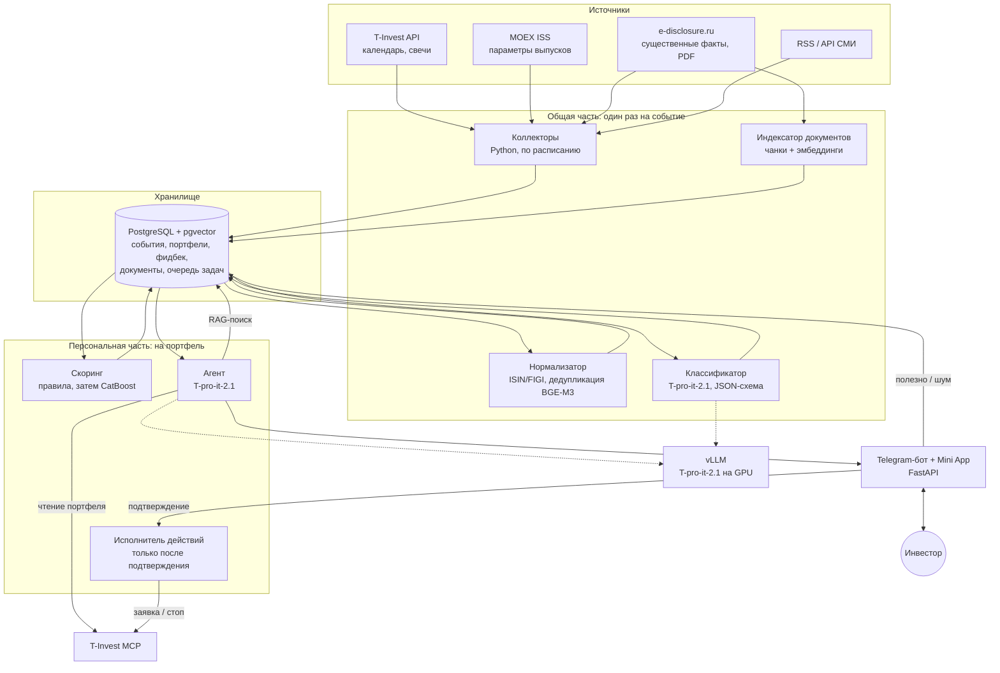
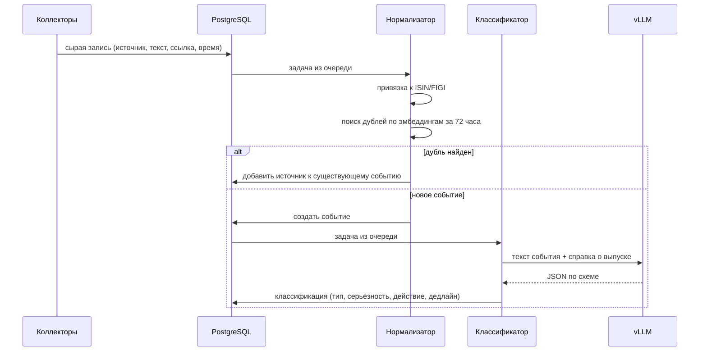
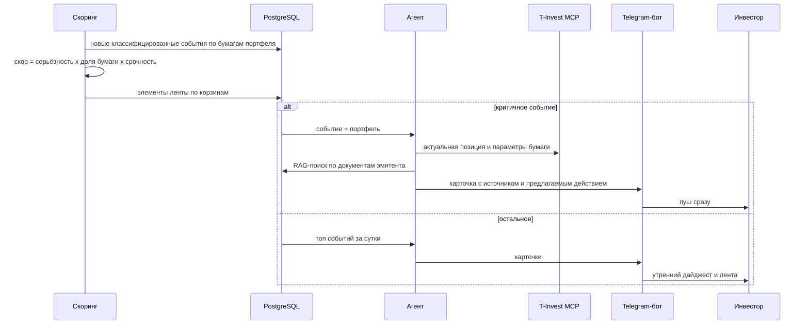
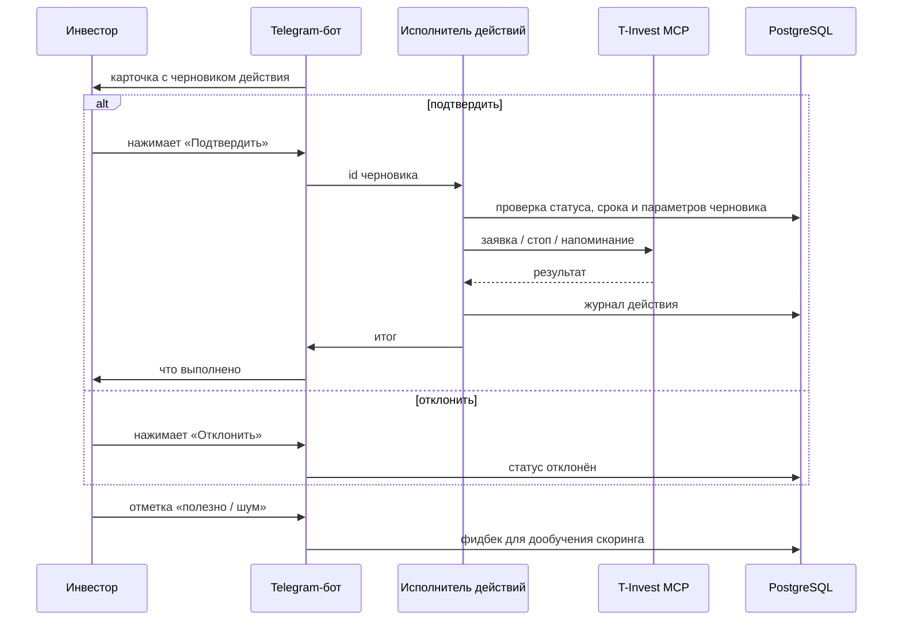

# Архитектура MVP

Система делится на две части с разной стоимостью:

1. **Общая часть.** Сбор, нормализация и классификация событий. Каждое событие обрабатывается LLM **один раз**, результат переиспользуется для всех пользователей, у кого есть эта бумага.
2. **Персональная часть.** Скоринг под конкретный портфель, сборка карточки агентом, доставка и обработка подтверждений. LLM здесь вызывается только для событий, попавших в верх ленты.

## Компоненты

| Компонент | Что делает | Технологии |
|---|---|---|
| Коллекторы | Забирают календарь событий, свечи, существенные факты, новости и складывают сырые записи | Python, планировщик, T-Invest API, MOEX ISS, e-disclosure.ru, RSS |
| Нормализатор | Привязывает запись к инструменту (ISIN, FIGI, тикер), склеивает дубли одного события из разных источников | Справочник инструментов, эмбеддинги BGE-M3, порог косинусной близости + окно по времени |
| Классификатор | Определяет тип события, серьёзность, нужно ли действие и дедлайн | T-pro-it-2.1 через vLLM, вывод по [JSON-схеме](../schemas/event_classification.schema.json) |
| Индексатор документов | Режет условия выпусков и отчётность на чанки, считает эмбеддинги | PDF-парсер, BGE-M3, pgvector |
| Скоринг | Ранжирует события для конкретного портфеля и раскладывает по корзинам | Правила на старте, CatBoost после накопления фидбека |
| Агент | Собирает карточку: что случилось, почему важно для этого портфеля, источник, предлагаемое действие | T-pro-it-2.1, инструменты: T-Invest MCP (чтение), RAG-поиск |
| Исполнитель действий | Выполняет действие, которое пользователь подтвердил кнопкой | Отдельный сервис, T-Invest MCP |
| Интерфейс | Пуши по критичному, утренний дайджест, лента, кнопки «подтвердить / отклонить», «полезно / шум» | Telegram-бот, Telegram Mini App, FastAPI |
| Хранилище | События, классификации, портфели, ленты, действия, фидбек, документы, очередь задач | PostgreSQL + pgvector, схема в [db/schema.sql](../db/schema.sql) |

## Потоки

### 1. Новое событие (общая часть)

Календарные события (купон, оферта, погашение, дивиденд) приходят уже структурированными из T-Invest API и MOEX ISS, их тип и дата известны без LLM. Классификатор нужен для текстов: существенных фактов и новостей.

### 2. Персональная лента и дайджест

### 3. Подтверждение действия

## Почему выбраны эти технологии

| Решение | Почему |
|---|---|
| T-pro-it-2.1 | Открытая модель Т-Банка: 33B на базе Qwen3-32B, лицензия Apache-2.0, сильна на русском, поддерживает вызов инструментов. Данные портфелей не уходят во внешние API. |
| vLLM | OpenAI-совместимый сервер, умеет ограничивать вывод JSON-схемой, поэтому классификатор не ломается на невалидном ответе |
| T-Invest API для коллекторов, MCP для агента | Массовый сбор по расписанию надёжнее и дешевле делать прямыми вызовами API. MCP нужен там, где модель сама решает, какой контекст портфеля подтянуть и какое действие подготовить |
| BGE-M3 | Открытая мультиязычная модель эмбеддингов с хорошим русским; одна модель и для дедупликации, и для RAG |
| Правила, затем CatBoost | В начале фидбека нет, обучать не на чем. Правила дают прозрачную базу, CatBoost подключается по мере накопления отметок «полезно / шум» |
| Только PostgreSQL + pgvector | При объёме MVP одна база закрывает и данные, и векторный поиск, и очередь задач (`SELECT ... FOR UPDATE SKIP LOCKED`). Меньше компонентов: быстрее собрать и проще сопровождать |
| Telegram-бот + Mini App | Пуши, дайджест и лента в одном месте, пользователю не нужно переходить в отдельное приложение |
| e-disclosure.ru | Официальный центр раскрытия: существенные факты появляются там первыми и в стандартном виде |

## Безопасность агента

Агент работает с брокерским счётом, поэтому ограничения заложены в архитектуру, а не только в промпт.

- **Разделение чтения и записи.** В цикле агента доступны только инструменты чтения MCP: портфель, параметры инструментов, котировки. Инструменты, которые выставляют заявки, есть только у отдельного исполнителя.
- **Человек в контуре.** Агент создаёт черновик действия с конкретными параметрами. Исполнитель выполняет ровно этот черновик и только после нажатия кнопки пользователем. Черновик имеет срок жизни, повторное подтверждение не срабатывает.
- **Ограничения на действия.** Объём заявки не больше текущей позиции, только бумаги из портфеля, без маржинальных операций.
- **Тексты как данные.** Новости и сообщения эмитентов могут содержать попытки prompt injection. Классификатор не имеет инструментов вообще, а агент получает текст события в изолированном блоке и опирается на структурированные поля классификации.
- **Объяснимость.** Каждая карточка ссылается на исходное сообщение и фрагменты документов, на которых построено объяснение.
- **Журнал.** Все черновики, подтверждения и вызовы MCP логируются.
- **Без рекомендаций.** Формулировки описывают событие и возможные действия, решение принимает пользователь.

## Развёртывание MVP

- Один GPU-сервер под vLLM с T-pro-it-2.1. Модель на 33B параметров требует видеокарту уровня 80 ГБ в BF16 или квантованную версию на карте меньшего объёма; на время MVP сервер арендуется.
- Отдельная VM под PostgreSQL + pgvector, коллекторы, скоринг, агент и бэкенд бота (Docker Compose).
- Нагрузка: при 1000 событиях в день классификация занимает около 1000 вызовов LLM в сутки, что одна GPU обслуживает с большим запасом.
