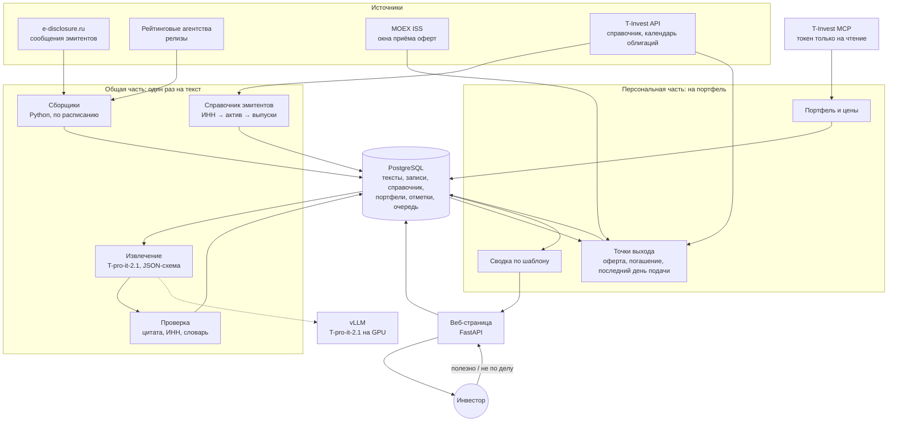
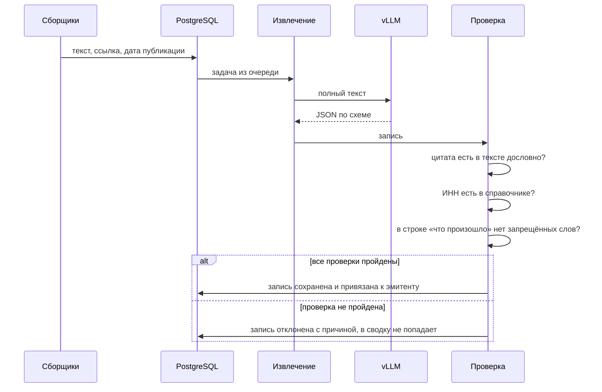
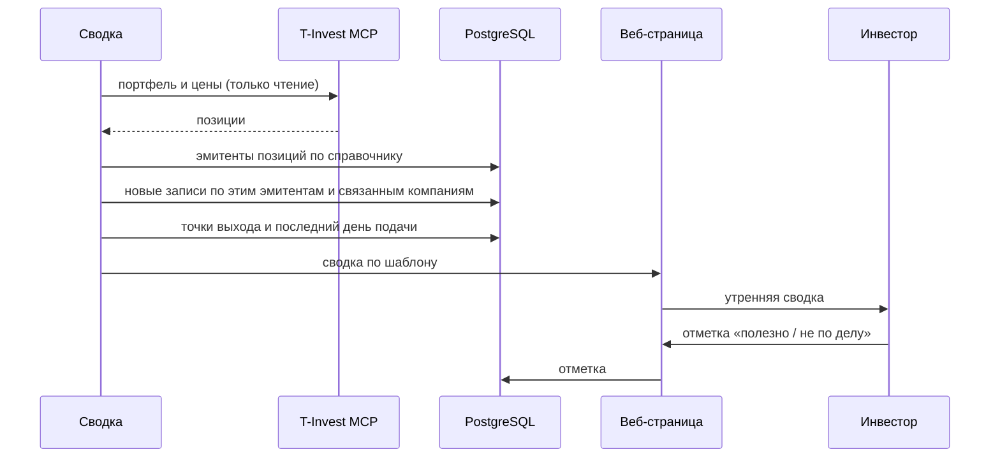

# Архитектура MVP

Система делится на две части:

1. **Общая часть.** Сбор текстов, извлечение события моделью, проверка и привязка к эмитенту. Каждый текст обрабатывается **один раз** для всех инвесторов.
2. **Персональная часть.** Портфель инвестора через MCP, привязка записей к его выпускам, точки выхода и сводка по шаблону. Модель здесь не вызывается.

## Компоненты

| Компонент | Что делает | Технологии |
|---|---|---|
| Сборщики | Забирают сообщения эмитентов и релизы рейтинговых агентств, сохраняют текст, ссылку и дату публикации | Python, планировщик, HTML и PDF в текст |
| Справочник эмитентов | Связывает ИНН эмитента с активом и всеми его выпусками | T-Invest API (`GetAssetBy`, `Bonds`), MOEX ISS |
| Извлечение | По каждому тексту заполняет схему: компания, связанные компании, что произошло, тип события, касается ли выплат, рейтинга или условий, дата, цитата | T-pro-it-2.1 через vLLM, вывод по [JSON-схеме](../schemas/event_classification.schema.json) |
| Проверка | Отбрасывает запись, если цитаты нет в тексте дословно или ИНН не найден в справочнике; проверяет строку «что произошло» на запрещённые слова | Python |
| Портфель и цены | Читает позиции и цены инвестора | T-Invest MCP, только чтение |
| Точки выхода | Находит ближайшую оферту, погашение или амортизацию по выпускам инвестора и считает последний день подачи: конец приёма у эмитента минус три рабочих дня | Календарь событий облигации (`GetBondEvents`), окна приёма из MOEX ISS, производственный календарь |
| Сводка | Собирает по шаблону хронологию по эмитентам портфеля, доли, цены, точки выхода, цитаты и ссылки | Python, шаблон |
| Интерфейс | Утренняя сводка на веб-странице, отметка «полезно / не по делу» у каждой записи | FastAPI |
| Хранилище | Тексты, записи, справочник, снимки портфеля, отметки, очередь задач | PostgreSQL, схема в [db/schema.sql](../db/schema.sql) |

## Потоки

### 1. Новый текст (общая часть)

### 2. Утренняя сводка (персональная часть)

### 3. Ретро-прогон

Те же сборщики, извлечение и проверка, но на текстах за 12 месяцев до первой невыплаты по выборке эмитентов. Сводка строится на каждый день прошлого периода. Метрики считаются по протоколу в [experiment.md](experiment.md).

## Почему выбраны эти технологии

| Решение | Почему |
|---|---|
| T-pro-it-2.1 | Открытая модель Т-Банка: 33B на базе Qwen3-32B, лицензия Apache-2.0, сильна на русском. Работает на нашей инфраструктуре |
| vLLM | OpenAI-совместимый сервер, умеет ограничивать вывод JSON-схемой, поэтому извлечение не ломается на невалидном ответе |
| Проверка цитаты кодом | Самый дешёвый способ поймать выдуманный факт: если цитаты нет в тексте дословно, записи нет |
| T-Invest API для справочника, MCP для портфеля | Справочник и календарь общие для всех, их надёжнее брать прямыми вызовами по расписанию. Портфель личный, его читает MCP токеном инвестора |
| Только PostgreSQL | При объёме MVP одна база закрывает данные и очередь задач (`SELECT ... FOR UPDATE SKIP LOCKED`) |
| Веб-страница, а не мессенджер | Финансовые данные не проходят через сторонний мессенджер, страницу проще показать на демо |
| e-disclosure.ru и сайты агентств | Первоисточники: сообщения эмитентов и рейтинговые действия появляются там в исходном виде |

## Ограничения, заложенные в архитектуру

- **Только чтение.** Токен T-Invest только на чтение, торговые инструменты MCP не вызываются. В системе нет компонента, который мог бы отправить заявку.
- **Без оценок и рекомендаций.** Модель не выставляет серьёзность и не оценивает эмитента. Сводка собирается шаблоном. Строка «что произошло» проверяется на запрещённые слова: «покупать», «продавать», «держать», «рекомендуем», «выгодно», «опасно» и похожие.
- **Тексты как данные.** Сообщения и новости могут содержать попытки prompt injection. У модели нет инструментов, она только заполняет схему, а результат проходит проверку кодом.
- **Объяснимость.** Каждая запись в сводке — это дословная цитата и ссылка на первоисточник.
- **Персональные данные.** Модель видит только публичные тексты. Портфель обрабатывается кодом и не передаётся в модель.
- **Журнал.** Вызовы MCP, отклонённые записи и причины отклонения логируются.

## Развёртывание MVP

- Один GPU-сервер под vLLM с T-pro-it-2.1. Модели на 33B параметров нужна видеокарта уровня 80 ГБ в BF16 или квантованная версия на карте меньшего объёма; на время MVP сервер арендуется.
- Отдельная VM под PostgreSQL, сборщики, справочник, сводку и веб-страницу (Docker Compose).
- Нагрузка: каждый текст обрабатывается один раз, независимо от числа инвесторов. Реальный поток текстов по эмитентам выборки измерим на первой выгрузке.
